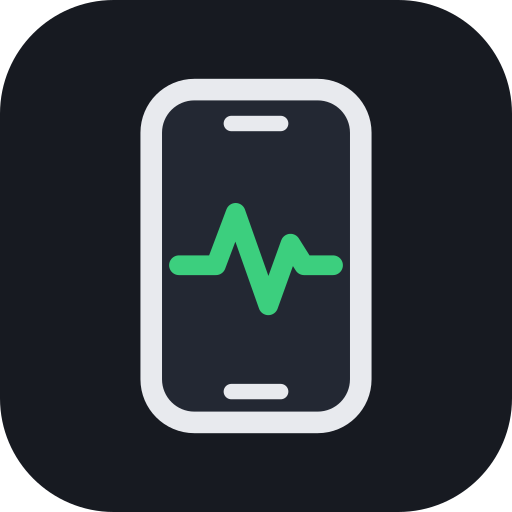
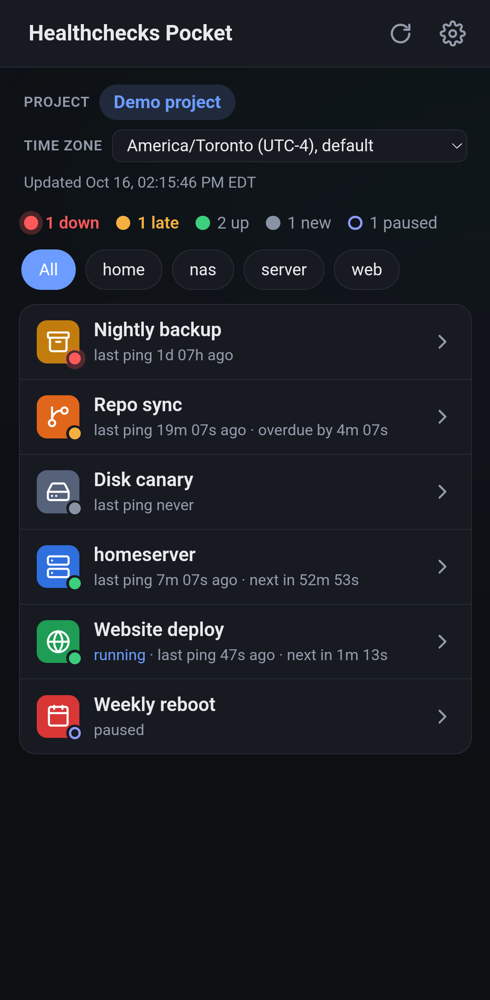
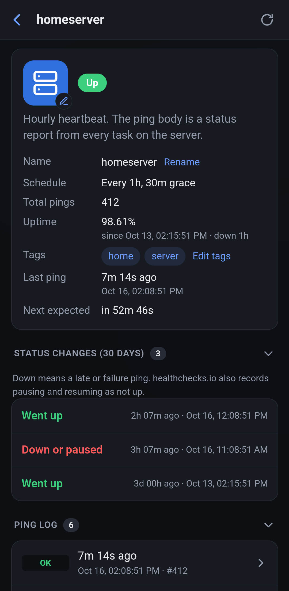
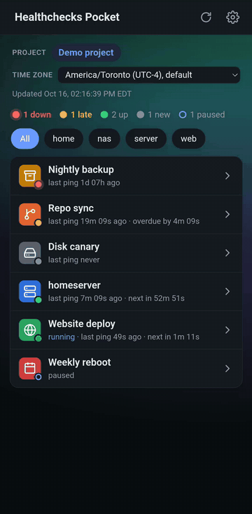

<p align="center"></p>

<h1 align="center">Healthchecks Pocket</h1>

An unofficial Android app for [Healthchecks.io](https://healthchecks.io) and self-hosted
[Healthchecks](https://github.com/healthchecks/healthchecks).

## Features

- Checks at a glance, down and late first
- Ping logs with errors and warnings highlighted
- Several projects, including self-hosted servers

<p>
  
  
  
</p>

More screenshots in the [gallery](GALLERY.md).

## Install

Requires Android 7.0+ with an up-to-date WebView: version 111 or later, updated from Google Play (as Android System
WebView, or Chrome on Android 7 to 9). The app says so if yours is older. Either:

- **Download** the latest APK from [Releases](../../releases) and open it on your phone. To update, install a newer
  APK over it.
- **Build from source** (Node.js 22.12+, JDK 21, Android SDK; `scripts/setup.sh` offers to install what's missing):

  ```bash
  git clone https://github.com/Yimaha/healthchecks-pocket.git && cd healthchecks-pocket
  scripts/setup.sh
  npm run android:phone     # build, install and open on a USB-connected phone (USB debugging on)
  ```

Then create an API key: open your project on [healthchecks.io/projects](https://healthchecks.io/projects/) (or your
own server), then **Settings → API Access**. Read-only keys show statuses only (no ping logs, pausing or tag edits).

## Privacy

API keys stay on your phone, encrypted with an Android Keystore key, and are only sent to the server you entered. No
backend, analytics or tracking. Once a day the app asks GitHub for the latest release, sending nothing about you
(turn it off in Settings → Updates).

### Backup and moving to a new phone

Android backup (to your Google account) and phone-to-phone transfer carry the app's settings to a new phone:

- Theme, time zone and view options
- Project names and server URLs (a self-hosted server's can be an internal hostname)
- Check icons, including images you uploaded (cropped and re-encoded, so their EXIF data, such as location, is gone)

API keys aren't included: paste them again on the new phone. If you turn off *Keep API keys on this device only* in
Settings, the keys are saved unencrypted with the settings and carried over too:

- **Phone-to-phone transfer** copies them straight to the new phone.
- **Google backup** includes them only if your phone has a screen lock (PIN, pattern or password), which encrypts the
  backup on the phone. Without one they're left out, and on Android 12 and later so is the rest of the backup.
- **On Android 7 and 8**, backups can't be encrypted on the phone, so the keys go to Google in plain text.
- **Turning the option back on** removes the keys from this phone, but your last backup keeps them until Android makes
  the next one (usually within a day). If that matters, create new keys in your project's **Settings → API Access**
  and delete the old ones.

## Roadmap

- [iOS support](https://github.com/Yimaha/healthchecks-pocket/issues/3)

## Development

```bash
scripts/setup.sh --emulator   # also creates an emulator
npm run dev                   # web version for development, http://localhost:5173
npm run android:build         # debug APK
npm run android:run           # build and launch on an emulator or device
```

### Testing

| Command | Covers |
|---|---|
| `npm run build` | Type-check and build |
| `npm run lint` | Code (oxlint), semicolons everywhere (ESLint; `npx eslint --fix .` adds them), shell scripts (ShellCheck), GitHub workflows (actionlint) |
| `npm test` | Unit and screen tests (Vitest) |
| `npm run test:coverage` | The same, with line and branch coverage of `src/` (report in `coverage/index.html`) |
| `npm run test:e2e` | Production build in a phone-sized browser (Playwright; `npx playwright install chromium` once) |
| `npm run test:android` | The debug app on the Android emulator (`scripts/android.sh emulator` first): see [misc.md](misc.md#tests-on-the-emulator) |

Tests pin exact wording, so update them when you change what the app says. CI runs them on every push (the emulator
tests on `main` only), and a release isn't built unless they all pass. Releasing and architecture: [misc.md](misc.md).

## License

[AGPL-3.0-or-later](LICENSE). Not affiliated with or endorsed by Healthchecks.io.
