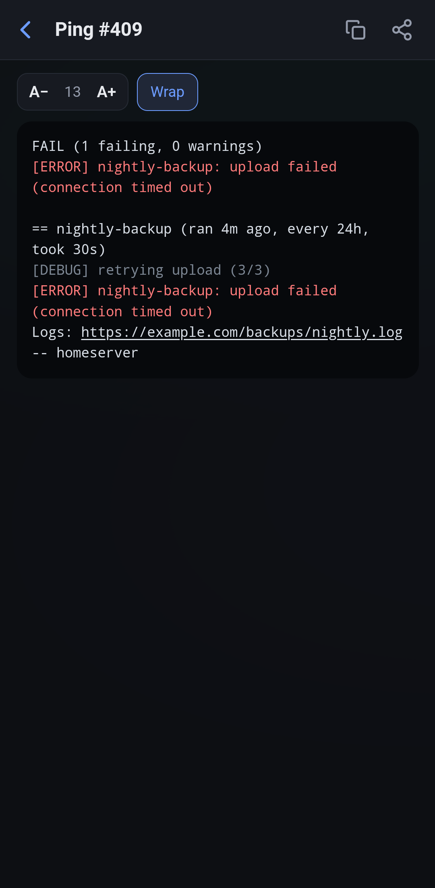
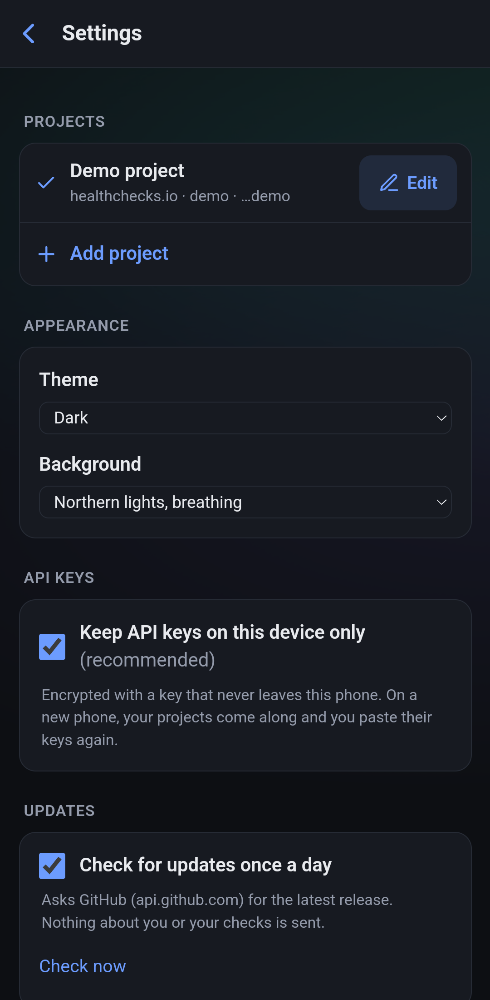
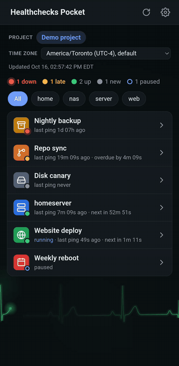

# Gallery

Healthchecks Pocket on Android, with the built-in demo project (paste `demo` as the API key to try it yourself).

## In use

From the check list to a check, then a failed run's ping log, and back.

## Check list

Every check with its icon and status, down and late first, with a summary of how many are down, late and up, and
tags to filter by.

## A check

Its status, schedule, uptime and tags, the times it went down and up, and its latest pings.

## Ping log

What a run sent, with errors in red and debug lines dimmed. Copy or share it, change the text size, or turn off
wrapping.

## Settings

Projects, appearance, where API keys are kept, and update checks.

## Heartbeat monitor background

One of the backgrounds to pick in Settings: a heartbeat trace, drawn the way a bedside monitor draws it, beating at
a resting heart rate. Shown in the dark theme, then the light one.

---

Taken on the Android emulator by `scripts/demo-media.sh` (see [misc.md](misc.md#demo-screenshots-and-video)).
